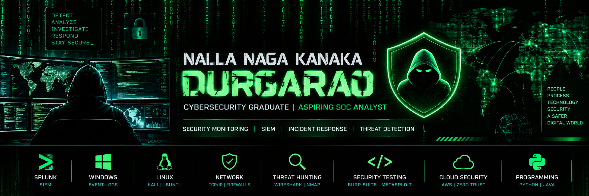

# Hi, I'm Naga Kanaka Durgarao 👋

### Cybersecurity Graduate | Aspiring SOC Analyst

I'm a cybersecurity graduate interested in Security Operations Center (SOC) operations, SIEM monitoring, incident investigation, network security, and threat detection.

I build practical security labs and document my investigations to strengthen my hands-on skills.

## 🎯 Core Skills

- **SOC & SIEM:** Splunk, log analysis, alert investigation
- **Endpoint Security:** Sysmon, Windows event logs
- **Network Security:** TCP/IP, DNS, Wireshark, Nmap, firewalls
- **Security Testing:** Burp Suite, Metasploit, vulnerability assessment
- **Operating Systems:** Windows, Kali Linux, Ubuntu
- **Programming:** Python fundamentals, Java fundamentals

## 🛡️ Featured Projects

### 1. Splunk SIEM Monitoring Lab
- Windows event log monitoring and analysis
- Detection searches and authentication-event investigation
- SIEM dashboards and alerting practice

[View repository](https://github.com/Durgarao1322/splunk-soc-lab-project)

### 2. SOC Incident Investigation Lab
- Document investigation scenarios and evidence
- Practice event correlation and incident triage
- Record findings and recommended response actions

  [View repository]https://github.com/Durgarao1322/Soc_Incident_Investigation_Lab.git

### 3. Cybersecurity Portfolio
My projects, technical skills, education, and resume.

[Visit portfolio](https://durgarao1322.github.io/durgarao2213.github.io-/)

## 🎓 Education

**B.Tech — Computer Science and Engineering (Cybersecurity)**  
Swarnandhra College of Engineering and Technology | 2023–2026

## 📫 Connect With Me

- GitHub: https://github.com/Durgarao1322
- LinkedIn: https://www.linkedin.com/in/naga-kanaka-durgarao-nalla-8413bb2bb
- Email: ndurgarao033@gmail.com

---
*Continuously learning, building, and documenting cybersecurity skills.*
